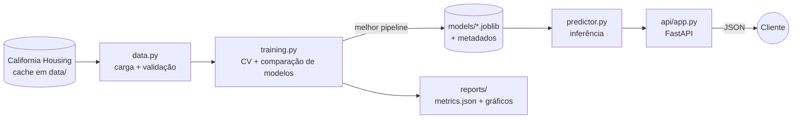

<h1 align="center">🏠 House Price Prediction — ML Pipeline & REST API</h1>

<p align="center">
  Pipeline de Machine Learning de ponta a ponta (dados → treino → avaliação → API) para prever o preço mediano de imóveis na Califórnia.
</p>

<p align="center">
  
  
  
  
  
  
  
  
</p>

---

## 🎯 O problema e a solução

Estimar o valor de um imóvel é um problema clássico de regressão com aplicação direta em mercado imobiliário, crédito e seguros. Este projeto transforma um estudo de Machine Learning em um **sistema reproduzível e servível**:

- **Treino automatizado**: compara modelos (Regressão Linear × Random Forest) com validação cruzada e escolhe o melhor **sem olhar o conjunto de teste**.
- **Pipelines do scikit-learn**: pré-processamento e modelo no mesmo objeto, evitando *data leakage*.
- **API REST (FastAPI)**: o modelo treinado é exposto com validação de entrada, documentação OpenAPI automática e previsão em lote.
- **Qualidade de engenharia**: código modular, tipado, com logging, tratamento de exceções, testes automatizados, Docker e CI.

**Dataset:** [California Housing](https://scikit-learn.org/stable/datasets/real_world.html#california-housing-dataset) (~20 mil distritos; renda média, idade das casas, ocupação, localização etc.). O alvo (`MedHouseVal`) está em unidades de US$ 100 mil — a API já devolve o valor em dólares.

## 🏗️ Arquitetura



```text
house-price-ml-project/
├── main.py                  # CLI: eda | train | predict | serve
├── src/house_price/
│   ├── config.py            # Settings via variáveis de ambiente (.env)
│   ├── data.py              # carga, cache e validação do dataset
│   ├── modeling.py          # Pipelines candidatos + grade de hiperparâmetros
│   ├── training.py          # CV, comparação, tuning opcional e persistência
│   ├── evaluation.py        # MAE, MSE, RMSE, R²
│   ├── visualization.py     # gráficos salvos em reports/figures
│   ├── predictor.py         # carrega o modelo e prevê (em US$)
│   ├── exceptions.py        # exceções de domínio
│   └── api/                 # app FastAPI + schemas Pydantic
├── tests/                   # pytest (dados sintéticos, sem rede)
├── .github/workflows/ci.yml # lint + testes em Python 3.10 e 3.12
├── Dockerfile · Makefile · pyproject.toml
└── .env.example · requirements.txt · requirements-dev.txt
```

**Decisões de projeto**

| Decisão | Motivo |
|---|---|
| Seleção do modelo por R² em validação cruzada **no treino** | O conjunto de teste fica intocado para a avaliação final honesta |
| `Pipeline` (scaler + modelo) | Pré-processamento aprendido só no treino, sem vazamento |
| Modelo salvo junto de metadados (métricas, versão do scikit-learn, data) | Rastreabilidade do artefato |
| Gráficos salvos em disco (backend `Agg`) | Roda em servidor, Docker e CI sem janela |
| Cache local do dataset em `data/` | Download só na primeira execução |
| Validação de faixas no schema da API | Evita previsões fora da região coberta pelo dataset |

## 📈 Resultados

Métricas no conjunto de teste (20%, `random_state=42`). Geradas por `make train` e gravadas em `reports/metrics.json`.

| Modelo | MAE | RMSE | R² |
| 0.5558915986952444 | 0.5332001304956565 | 0.7455813830127764 | 0.5757877060324508 |
| Regressão Linear | – | – | – |
| Random Forest | – | – | – |

> MAE e RMSE estão em unidades de US$ 100 mil.

Gráficos gerados automaticamente em `reports/figures/`: distribuição de preços, correlação, previsão × real e importância das variáveis.

## 🔌 Endpoints da API

| Método | Rota | Descrição |
|---|---|---|
| `GET` | `/health` | Status do serviço e se o modelo está carregado |
| `GET` | `/api/v1/model` | Metadados do modelo (métricas, hiperparâmetros, data de treino) |
| `POST` | `/api/v1/predict` | Previsão para um imóvel |
| `POST` | `/api/v1/predict/batch` | Previsão em lote (até 1000 imóveis) |

Documentação interativa (Swagger): `http://localhost:8000/docs`

```bash
curl -X POST http://localhost:8000/api/v1/predict \
  -H "Content-Type: application/json" \
  -d '{
    "MedInc": 8.3252, "HouseAge": 41, "AveRooms": 6.98, "AveBedrms": 1.02,
    "Population": 322, "AveOccup": 2.56, "Latitude": 37.88, "Longitude": -122.23
  }'
# {"predicted_price_usd": 4xxxxx.xx}
```

Entradas inválidas (ex.: `Latitude` fora da Califórnia) retornam `422`; se o modelo ainda não foi treinado, as rotas de previsão retornam `503`.

## 🚀 Como executar

**Pré-requisitos:** Python 3.10+ (e Docker, opcional).

```bash
# 1. Clonar
git clone https://github.com/SimoesBia/house-price-ml-project.git
cd house-price-ml-project

# 2. Ambiente virtual + dependências
python -m venv .venv
source .venv/bin/activate          # Windows: .venv\Scripts\activate
pip install -r requirements.txt

# 3. Configuração (opcional — há valores padrão)
cp .env.example .env

# 4. Treinar (baixa o dataset na 1ª vez) e gerar métricas/gráficos
python main.py train               # ou: make train
python main.py train --tune        # com GridSearchCV no Random Forest

# 5. Subir a API
python main.py serve               # ou: make serve  →  http://localhost:8000/docs
```

Outros comandos úteis:

```bash
python main.py eda                 # gráficos da análise exploratória
python main.py predict --MedInc 8.3 --HouseAge 41 --AveRooms 7 --AveBedrms 1 \
                       --Population 322 --AveOccup 2.5 --Latitude 37.9 --Longitude -122.2

pip install -r requirements-dev.txt
make test                          # pytest + cobertura
make lint                          # ruff
```

**Com Docker** (treine antes, para existir `models/house_price_model.joblib`):

```bash
make docker-build
make docker-run
```

## 🔮 Melhorias futuras

- [ ] **MLOps:** rastreamento de experimentos e registro de modelos com MLflow
- [ ] **Modelos:** Gradient Boosting (XGBoost/LightGBM) e busca bayesiana com Optuna
- [ ] **Interpretabilidade:** valores SHAP por previsão, expostos em um endpoint `/explain`
- [ ] **Observabilidade:** métricas Prometheus, logs estruturados em JSON e detecção de *data drift*
- [ ] **Entrega contínua:** build e publicação da imagem Docker no CI + deploy (Render/Cloud Run)
- [ ] **Dados:** pipeline de ingestão com dados mais recentes e versionamento com DVC
- [ ] **Segurança:** autenticação por API key e *rate limiting*
- [ ] **Front-end:** dashboard (Streamlit) consumindo a API

## 👩‍💻 Autora

Desenvolvido por **Bruna Beatriz** — estudante de Ciência da Computação, com foco em Engenharia de Software, dados e IA.

[GitHub](https://github.com/SimoesBia)

## 📄 Licença

Distribuído sob a licença MIT. Veja [LICENSE](LICENSE).
